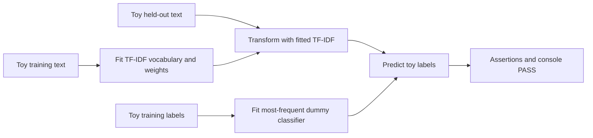
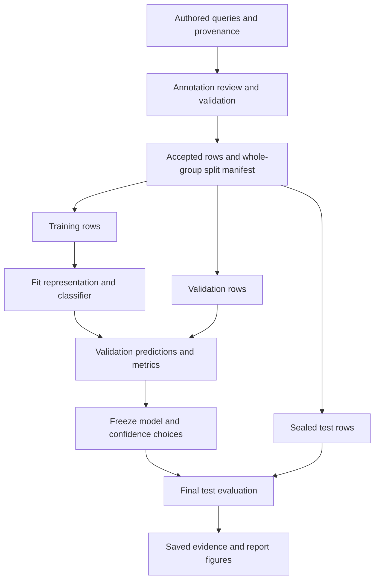

# Architecture

Orchestra is a local classification study: given a query, predict the first action needed to answer it. A router chooses an action; it does not itself answer the query. This document describes the implemented environment check and the proposed study. Progress and completion evidence live in the [roadmap](ROADMAP.md).

## Implemented today

The only executable project code is [scripts/smoke.py](scripts/smoke.py). uv creates a Python environment from `.python-version`, `pyproject.toml`, and `uv.lock`.

The script verifies sparse features, training-only vocabulary, and expected dummy predictions. It writes no dataset, model, or experiment results. Its `simple` and `complex` labels are fixtures, not the study's action labels. The [walkthrough](docs/repo-guide.md#the-executable-flow-today) explains the calls and library responsibilities.

## Proposed study

All components below are planned. The initial implementation remains a local batch workflow, with no server, UI, or tool execution. The [data and evaluation protocol](docs/data-and-evaluation.md) is authoritative for labels, row fields, splits, configurations, and metrics.

| Component | Responsibility and output | Proposed location |
| --- | --- | --- |
| Data validation | Check row fields, annotation status, duplicate IDs/text, and provenance. Only accepted rows enter supervised splits. | Reusable code under `src/orchestra/`; behavioral checks under `tests/`. |
| Split generation | Keep related query groups together; persist IDs and reject overlap or missing classes. | `data/splits/` and `data/manifests/`. |
| Training | Fit features and estimators on training rows through scikit-learn pipelines. Start with dummy and TF-IDF logistic regression. | `src/orchestra/`, `configs/`, and ignored `models/`. |
| Evaluation | Save predictions, macro-F1, per-class metrics, confusion matrices, timing, and run provenance. Validation selects systems before the final test. | Ignored `results/<run-id>/`. |
| Confidence analysis | Compare raw and calibrated probabilities. Fit calibration using group-aware training folds; select any fallback threshold on validation. | Training and evaluation code, resolved configurations, and run outputs. |
| Report evidence | Produce figures and explanations traceable to saved runs. Archive the files needed to reproduce ignored outputs. | Selected cleared files in `docs/evidence/` and a documented submission archive. |

These paths describe intended responsibilities, not existing modules or runnable commands. Add reusable modules when the first baseline needs them. The [project plan](docs/project-plan.md#decisions-and-rejected-alternatives) records why a package, service framework, and complete tool sequences are deferred.

## Query contract and boundaries

The proposed input is one self-contained English query. The output is one label: `document_retrieval`, `knowledge_lookup`, `calculation`, or `direct_answer`. For example, “What is 18 percent of 250?” has the target `calculation`, because the required numbers are already present. A future trained classifier may predict that label correctly or incorrectly; the study measures that distinction. It does not run a calculator.

Annotation metadata, including the gold label and rationale, must not enter the model's text features. `needs_review` describes an unresolved annotation and is not a target class. A later optional abstention decision is separate from both annotation status and action prediction.

Training alone learns vocabulary, weights, and model parameters. Related paraphrases stay in one split so validation and test do not contain near-copies of training examples. Test results cannot guide the reported model selection. The protocol specifies the detailed [leakage controls](docs/data-and-evaluation.md#split-responsibilities-and-leakage-controls).

## Dependencies and storage

Our code owns data checks, split assignment, experiment configuration, and evidence recording as those components are implemented. scikit-learn supplies representations and estimators; NumPy and SciPy supply numerical arrays and sparse operations. uv pins and installs the environment.

The current smoke check needs no credentials or GPU. The planned sparse study runs on a local CPU. External datasets and optional frozen embeddings require the protocol's license and resource checks before adoption.

Raw data, processed rows, full results, models, secrets, and course PDFs are ignored. Cleared fixtures, manifests, configurations, and selected report evidence can be tracked deliberately. Ignored artifacts need an explicit archive for reproduction. Storage rules and run metadata are defined in the [reproducibility protocol](docs/data-and-evaluation.md#reproducibility-and-resource-budget).

Update this overview when an implementation changes a component or boundary. Record completion evidence in the roadmap and decision rationale in the project plan.
