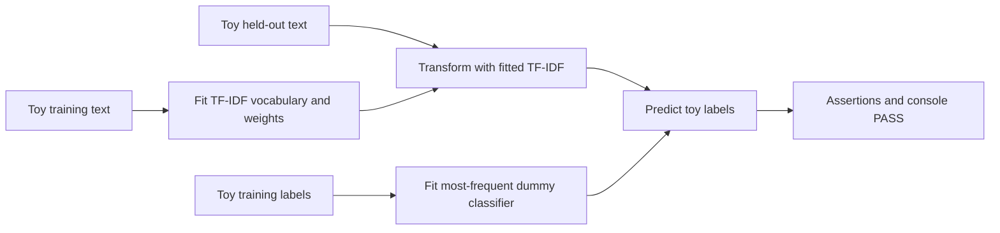
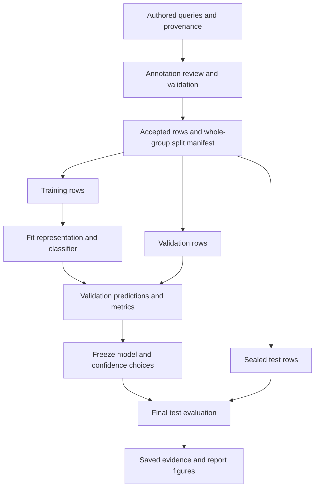

# Architecture

Orchestra is a local classification study: given a query, predict the first action needed to answer it. A router chooses an action; it does not itself answer the query. This document describes the implemented tooling and the research workflow awaiting accepted data. Progress and completion evidence live in the [roadmap](ROADMAP.md).

## Implemented today

The local `python -m orchestra` CLI covers preparation, splitting, experiment runs, selection, confidence, final evaluation, figures, and archives. The [walkthrough](docs/repo-guide.md) maps each module. All software acceptance runs use artificial fixtures; no research result exists. uv creates the locked Python environment. The small smoke script remains an independent environment check:

The script verifies sparse features, training-only vocabulary, and expected dummy predictions. It writes no dataset, model, or experiment results. Its `simple` and `complex` labels are fixtures, not the study's action labels. The [walkthrough](docs/repo-guide.md#the-executable-flow-today) explains the calls and library responsibilities.

## Study workflow

All components below are implemented and fixture-tested. The study remains a local batch workflow, with no server, UI, or tool execution. The [data and evaluation protocol](docs/data-and-evaluation.md) is authoritative for labels, row fields, splits, configurations, and metrics.

| Component | Responsibility | Module |
| --- | --- | --- |
| Data and preparation | Validate rows, provenance, permission and human review; make blind worksheets and hash-bound prepared configs. | `data.py`, `study.py` |
| Split generation | Keep groups intact; bind content hashes; extend without moving old rows. | `splits.py` |
| Training and selection | Fit complete pipelines on train only; record all 14 outcomes; select on validation; compare relocated reproduction. | `experiment.py` |
| Confidence and final test | Reproduce raw scores, calibrate in grouped train folds, interpret validation errors, freeze choices, and evaluate through a split-specific receipt. | `confidence.py` |
| Figures | Export saved evidence with exact plot data and fixture labeling. | `figures.py` |
| Reproduction | Archive explicit regular files, validate hashes and paths, restore executable permissions into a fresh directory. | `archive.py` |

The CLI is a thin dispatcher. There is no service, workflow scheduler, or tool executor. The [automation plan](docs/automation-plan.md) records the design and library choices. Source, dependency, input, and artifact hashes keep the selected experiment distinct from a changed rerun. Preparation can read full data to make splits; fitting and calibration read only train and validation until the explicit final-test command.

## Query contract and boundaries

The input contract is one self-contained English query. The output is one label: `document_retrieval`, `knowledge_lookup`, `calculation`, or `direct_answer`. For example, “What is 18 percent of 250?” has the target `calculation`, because the required numbers are already present. A future trained classifier may predict that label correctly or incorrectly; the study measures that distinction. It does not run a calculator.

Annotation metadata, including the gold label and rationale, must not enter the model's text features. `needs_review` describes an unresolved annotation and is not a target class. A later optional abstention decision is separate from both annotation status and action prediction.

Training alone learns vocabulary, weights, and model parameters. Related paraphrases stay in one split so validation and test do not contain near-copies of training examples. Test results cannot guide the reported model selection. The protocol specifies the detailed [leakage controls](docs/data-and-evaluation.md#split-responsibilities-and-leakage-controls).

## Dependencies and storage

Our code owns data checks, split assignment, experiment configuration, and evidence recording through the implemented modules. scikit-learn supplies representations and estimators; NumPy and SciPy supply numerical arrays and sparse operations. Matplotlib exports scientific figures. uv pins and installs the environment.

The current smoke check needs no credentials or GPU. The planned sparse study runs on a local CPU. External datasets and optional frozen embeddings require the protocol's license and resource checks before adoption.

Raw data, processed rows, full results, models, secrets, and course PDFs are ignored. Cleared fixtures, manifests, configurations, and selected report evidence can be tracked deliberately. Ignored artifacts need an explicit archive for reproduction. Storage rules and run metadata are defined in the [reproducibility protocol](docs/data-and-evaluation.md#reproducibility-and-resource-budget).

Update this overview when an implementation changes a component or boundary. Record completion evidence in the roadmap and decision rationale in the project plan.
